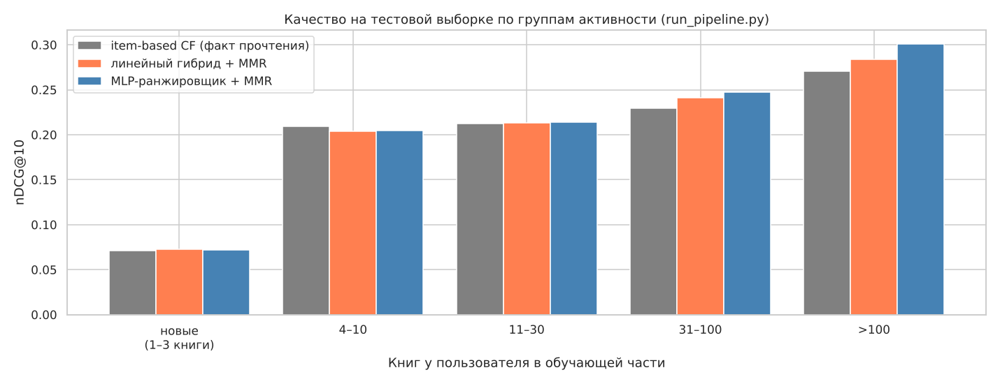

# Гибридная система рекомендаций книг на Goodbooks-10k

Итоговый проект по рекомендательным системам. Продолжает домашнее задание [goodbooks-recsys](https://github.com/EgorCOStylev/goodbooks-recsys): модели оттуда (item-based CF, контентная модель, SVD, популярность) становятся генераторами кандидатов. Поверх них построены линейный гибрид с отдельными весами для новых и активных пользователей, нейросетевой ранжировщик (MLP) и переранжирование по жанрам для разнообразия. Весь процесс от сырых CSV до метрик и рекомендаций запускается одной командой.

## Данные

[Goodbooks-10k](https://www.kaggle.com/datasets/zygmunt/goodbooks-10k), первая версия: 981 756 оценок от 53 424 пользователей по 10 000 книг, шкала 1–5, временных меток нет. Плюс `books.csv` (авторы, год, число оценок на Goodreads), `tags.csv` и `book_tags.csv` (теги и их частота у каждой книги).

Подробный разбор данных в ноутбуке домашнего задания (`notebooks/01_homework_baselines.ipynb`). Для этого проекта важны две особенности. У каждой книги в ratings.csv не больше 100 оценок (у 62,5% ровно 100), поэтому популярность на Goodreads почти не связана с тем, какие книги пользователь читает в датасете. Временных меток нет, поэтому разделение случайное внутри пользователя.

## Как устроена система

1. Шесть генераторов отдают каждому пользователю по 100 лучших непрочитанных книг: item-based CF на факте прочтения и на оценках, контентная модель на TF-IDF по тегам, SVD, популярность по `ratings_count` и сглаженная средняя оценка. Кандидаты объединяются в общий пул, в среднем около 470 книг на пользователя. Скор каждой модели в пуле заменяется рангом от 0 до 1, чтобы модели с разными шкалами можно было складывать.
2. Для каждого кандидата считаются признаки книги (популярность, сглаженная средняя, разброс оценок) и пары пользователь–книга (сумма и максимум item-based сходства с прочитанным, косинус к TF-IDF-профилю, пересечение жанров). Жанры получены из тегов по правилам (`src/recsys/features.py`), жанр есть у 98,8% книг. Все признаки считаются только по обучающей части.
3. Кандидаты ранжируются одним из двух способов. Линейный гибрид складывает колонки с весами, подобранными координатным подъёмом по nDCG@10 отдельно для новых (1–3 книги) и активных пользователей. MLP-ранжировщик (14 входов, слои 64 и 32, ReLU, dropout 0,1, бинарная кросс-энтропия) получает те же колонки и логарифм числа книг пользователя.
4. Из 50 лучших кандидатов MMR жадно набирает итоговые 10 с поправкой на сходство жанров (коэффициент Жаккара). Параметр λ = 0,8 выбран на валидации по правилу, заданному до запуска: наименьшее λ, при котором nDCG@10 не ниже 98% от выдачи без переранжирования.

## Протокол оценки

Тестовая выборка совпадает с тестом домашнего задания: 20% оценок у каждого пользователя с не менее чем 5 оценками, тот же seed. Из оставшейся части тем же способом отрезана валидация. Веса гибрида, λ и сеть подбираются на валидации, затем генераторы переобучаются на обучающей и валидационной частях вместе, и тест считается один раз.

Пользователи с историей короче 5 оценок целиком остаются в обучающей части и в оценке не участвуют, поэтому новые пользователи моделируются: у 3000 случайных пользователей с не менее чем 10 оценками история в обучающей части обрезается до 1, 2 или 3 книг, и модели обучаются уже на обрезанных данных.

Релевантны тестовые книги с оценкой не ниже 4. Precision@K, Recall@K и nDCG@K определены как в домашнем задании. На синтетических данных метрики, посчитанные по пулу, совпадают с `metrics.evaluate` из домашнего задания до четвёртого знака. На реальных данных item-based CF на факте прочтения даёт nDCG@10 0,2159 у активных пользователей, в домашнем задании было 0,2161 по всем тестовым пользователям. Разнообразие измеряется ILS (среднее попарное сходство жанров внутри списка, меньше значит разнообразнее) и числом жанров в топ-10.

## Результаты

Тестовая выборка, 30 542 пользователя (3000 смоделированных новых), числа из `run_pipeline.py`:

| Система | nDCG@10, все | nDCG@10, новые | nDCG@10, активные | Precision@10 | Recall@10 | ILS | Жанров в топ-10 |
|---|---|---|---|---|---|---|---|
| item-based CF (факт прочтения) | 0,2017 | 0,0711 | 0,2159 | 0,0759 | 0,2418 | 0,559 | 6,5 |
| линейный гибрид | 0,2018 | 0,0737 | 0,2157 | 0,0777 | 0,2443 | 0,553 | 6,6 |
| линейный гибрид + MMR | 0,2026 | 0,0729 | 0,2167 | 0,0787 | 0,2475 | 0,488 | 7,4 |
| MLP-ранжировщик | 0,2026 | 0,0717 | 0,2168 | 0,0792 | 0,2499 | 0,578 | 6,3 |
| MLP-ранжировщик + MMR | 0,2046 | 0,0716 | 0,2191 | 0,0802 | 0,2539 | 0,526 | 7,0 |

Активные пользователи по числу книг в обучающей части, nDCG@10:

| Книг | Пользователей | item-based CF | линейный гибрид + MMR | MLP + MMR |
|---|---|---|---|---|
| 4–10 | 10 747 | 0,2093 | 0,2039 | 0,2050 |
| 11–30 | 10 658 | 0,2127 | 0,2135 | 0,2143 |
| 31–100 | 5 592 | 0,2294 | 0,2409 | 0,2474 |
| >100 | 545 | 0,2709 | 0,2841 | 0,3012 |



Общий пул содержит 60,9% релевантных книг активного пользователя и 30,2% нового. У лучшей отдельной модели на валидации 49,8% и 20,6%, основной прирост даёт контентная модель.

## Выводы

Лучший результат по всем пользователям у MLP-ранжировщика с MMR: nDCG@10 0,2046 против 0,2017 у item-based CF на факте прочтения (+1,4%), Recall@10 0,2539 против 0,2418. Прирост держится на пользователях с длинной историей: при 31–100 и более чем 100 книгах ранжировщик лучше CF на 7,8% и 11,2%. У пользователей с 4–10 книгами все гибриды немного уступают CF.

Линейная сумма почти не использует запас общего пула. Разным пользователям нужны разные правила: при длинной истории точнее сходство с самой похожей прочитанной книгой, при короткой сумма сходств. Один набор весов на всех активных пользователей усредняет эти правила, и выигрыш у тяжёлых читателей съедается проигрышем у лёгких. MLP с признаком числа книг частично решает это: без признака сеть хуже CF в среднем по активным пользователям (nDCG@10 0,2085 против 0,2159) и в трёх группах активности из четырёх, а в группе больше 100 книг падает до 0,2564.

Популярность на этих данных не помогает даже новым пользователям: модель по `ratings_count` находит в топ-100 0,2–0,3% релевантных книг, а случайная выдача из 100 книг каталога в 10 000 нашла бы около 1%. Вероятная причина в ограничении 100 оценок на книгу при сборке датасета. Новым пользователям лучше всего подходит линейный гибрид (nDCG@10 0,0737 против 0,0711 у CF), где к CF добавлены контент и с небольшим весом популярность и SVD.

Переранжирование MMR почти бесплатно: у обоих гибридов оно добавляет около одного жанра в топ-10 и не снижает nDCG. У ранжировщика оно даже повышает nDCG (0,2026 и 0,2046), вероятно, потому что сеть собирает вверху списка книги одной серии.

Рекомендации по выбору. Для пользователей с короткой историей (4–10 книг) item-based CF на факте прочтения так же хорош и проще. Для пользователей с длинной историей стоит использовать ранжировщик. Для новых пользователей лучше линейный гибрид. MMR с λ = 0,8 включать везде. В `run_pipeline.py` финальные рекомендации строит ранжировщик с MMR как лучший по всем пользователям.

## Ограничения

Временных меток нет, разделение случайное и не имитирует будущее. Новые пользователи смоделированы обрезкой истории активных и могут отличаться от настоящих новичков. Значимость разниц между системами не проверялась: разница по всем пользователям составляет 0,001–0,003 nDCG и может быть в пределах шума, а в группе больше 100 книг всего 545 пользователей. Тестовая выборка открывалась несколько раз: в ноутбуке 02 при смене сетки весов, в ноутбуке 03 при смене лимита эпох. Оба изменения приняты по критериям на валидации, но повторные просмотры теста делают итоговые числа чуть оптимистичнее. Ранжировщик обучен поточечным лоссом, который не учитывает позицию в списке: его преимущество по Precision и Recall больше, чем по nDCG.

## Структура

```
├── run_pipeline.py                        запуск всего процесса одной командой
├── notebooks/
│   ├── 01_homework_baselines.ipynb        домашнее задание: EDA и базовые модели
│   ├── 02_hybrid.ipynb                    пул, признаки, линейный гибрид, MMR, выводы
│   └── 03_neural_ranker.ipynb             MLP-ранжировщик, сравнение с гибридом, выводы
├── src/recsys/
│   ├── data.py         загрузка, очистка, разделение на train/val/test, моделирование новых пользователей
│   ├── popularity.py   сглаженная средняя оценка
│   ├── content.py      служебные теги, профили книг, TF-IDF
│   ├── item_cf.py      сходство книг, прогнозы на явных и неявных данных
│   ├── svd.py          связка surprise SVD с матрицей оценок
│   ├── metrics.py      Precision@K, Recall@K, nDCG@K
│   ├── features.py     жанры по тегам, признаки пользователей, книг и пар
│   ├── hybrid.py       пул кандидатов, подбор весов, сегменты, MMR, метрики разнообразия
│   ├── ranker.py       MLP-ранжировщик на PyTorch
│   ├── pipeline.py     обучение генераторов, сборка пула, подбор весов
│   ├── run.py          этапы сквозного процесса и конфигурация
│   └── plots.py        таблицы результатов
├── reports/figures/    графики для README
└── requirements.txt
```

## Запуск

Весь процесс одной командой: загрузка и очистка, разделение, подбор весов, λ и обучение сети на валидации, оценка на тесте, рекомендации для всех пользователей по модели, обученной на всех оценках.

```
pip install -r requirements.txt
python run_pipeline.py --out reports/run
```

В Google Colab:

```
!git clone -q https://github.com/EgorCOStylev/goodbooks-hybrid-recsys.git
%cd goodbooks-hybrid-recsys
!pip install -q scikit-surprise
!python run_pipeline.py --out reports/run
```

В Colab на CPU прогон занимает около 23 минут. Данные скачиваются через kagglehub, своя папка с CSV в формате Goodbooks-10k передаётся флагом `--data`. Флаг `--config` принимает JSON с любыми полями класса `Config` из `src/recsys/run.py` (seed, порог релевантности, K, сетка весов, число эпох и т. д.), `--no-ranker` убирает нейросеть (PyTorch не нужен, рекомендации строит линейный гибрид), `--no-recommend` останавливает процесс после оценки на тесте.

В папке результатов появляются `config.json` (использованные параметры), `weights.json` (веса линейного гибрида), `ranker_history.csv` (обучение сети по эпохам), `metrics_test.csv` (все метрики по системам и группам), `summary.json` (размеры данных, λ, recall пула) и `recommendations.csv` (топ-10 для каждого пользователя с названиями и авторами).

Ноутбуки открываются в Colab с GitHub и выполняются целиком (Runtime → Run all), первая ячейка клонирует репозиторий. Если scikit-surprise не собирается под numpy 2, нужно поставить `numpy<2` и перезапустить среду.

## Базовые модели из домашнего задания

Для сравнения: результаты домашнего задания на той же тестовой выборке, без смоделированных новых пользователей (порог 4, 30 542 пользователя).

| Модель | Precision@10 | Recall@10 | nDCG@10 |
|---|---|---|---|
| Popularity (сглаженная средняя) | 0,0005 | 0,0015 | 0,0009 |
| SVD | 0,0005 | 0,0014 | 0,0010 |
| Content-based | 0,0423 | 0,1447 | 0,1094 |
| Item-based CF (оценки) | 0,0594 | 0,1621 | 0,1468 |
| Item-based CF (факт прочтения) | 0,0832 | 0,2561 | 0,2161 |
