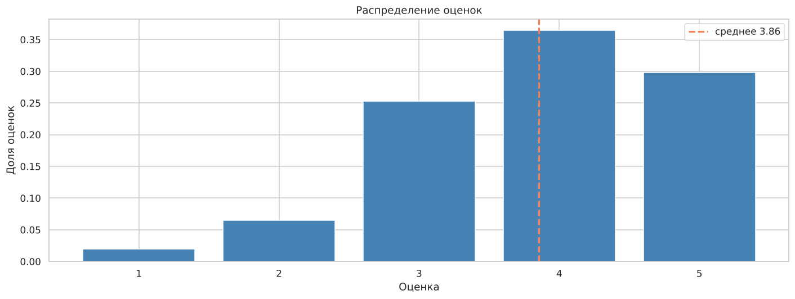
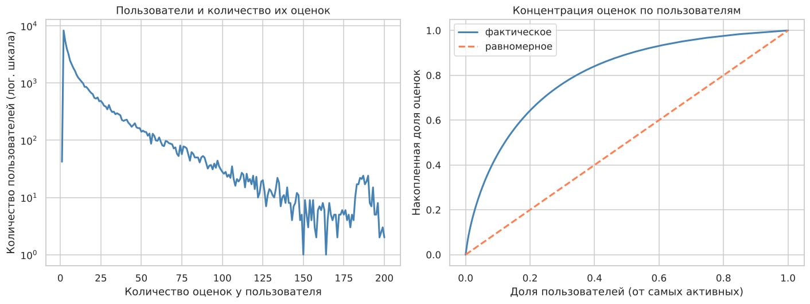
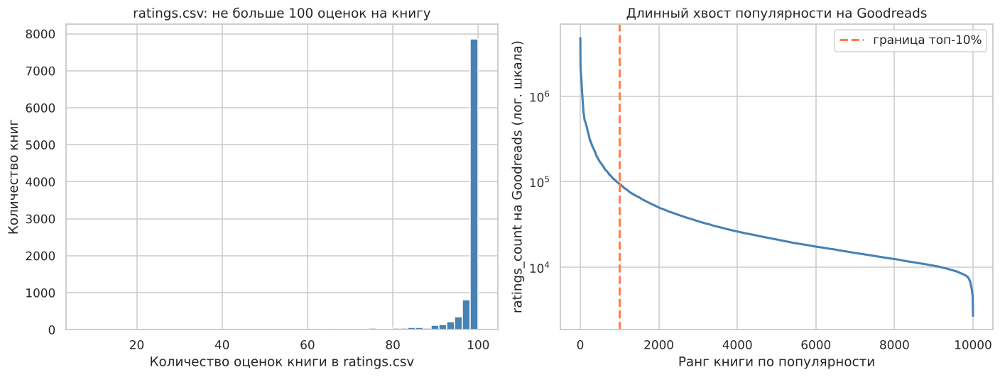
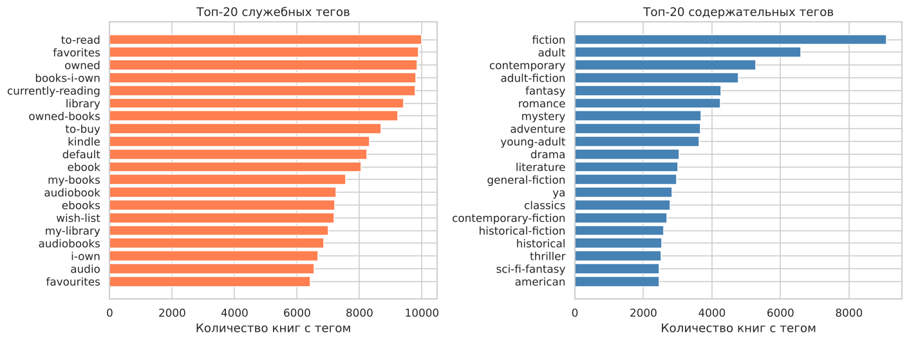
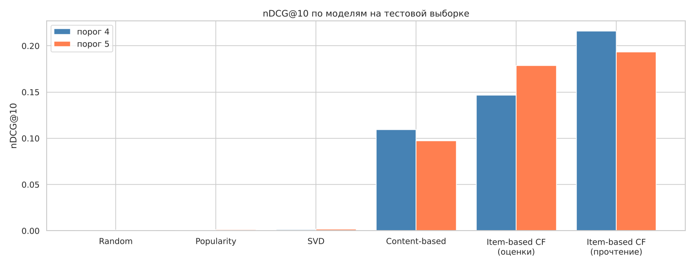

# Книжный рекомендательный сервис на Goodbooks-10k

Прототип рекомендательной системы для книг. На одних и тех же данных сравниваются неперсонализированная модель, контентная модель на TF-IDF, item-based коллаборативная фильтрация (на явных оценках и на факте прочтения) и SVD. Модели оцениваются по Precision@K, Recall@K, nDCG@K и RMSE. Отдельно разобраны холодный старт и ограничения офлайн-оценки.

## Данные

[Goodbooks-10k](https://www.kaggle.com/datasets/zygmunt/goodbooks-10k), первая версия: 981 756 оценок от 53 424 пользователей по 10 000 книг, шкала 1–5, временных меток нет. Плюс метаданные книг, теги и связи книга–тег.

Что нужно учесть до моделирования:

* 4 487 строк приходятся на повторные пары пользователь–книга, в 633 парах оценки различаются. Повторы схлопываются в среднюю оценку.
* book_tags.csv ссылается на книги через `goodreads_book_id`, ratings.csv через `books.id`, теги переводятся на `id`.
* У каждой книги не больше 100 оценок (у 62,5% ровно 100), поэтому длинного хвоста популярности в оценках не видно. Настоящая популярность видна по `ratings_count` на Goodreads: топ-10% книг собирают 57% оценок.
* Оценки смещены вверх: 66% оценок не ниже 4.
* Медиана 8 оценок на пользователя, у четверти пользователей не больше 3.
* 27 из 30 самых частых тегов служебные (to-read, owned, kindle) и для контентной модели удаляются.






## Структура

```
├── notebooks/goodbooks_recsys.ipynb   EDA, эксперименты, выводы
├── src/recsys/
│   ├── data.py         загрузка, очистка, разделение, индексы матрицы
│   ├── popularity.py   сглаженная средняя оценка
│   ├── content.py      фильтр служебных тегов, профили книг, TF-IDF
│   ├── item_cf.py      сходство книг, прогнозы на явных и неявных данных
│   ├── svd.py          связка surprise SVD с матрицей оценок
│   ├── metrics.py      Precision@K, Recall@K, nDCG@K, покрытие, доля знакомых авторов
│   └── plots.py        таблицы результатов
├── reports/figures/    графики для README
└── requirements.txt
```

## Запуск

Локально:

```
pip install -r requirements.txt
cd notebooks
jupyter notebook goodbooks_recsys.ipynb
```

В Google Colab:

```
!git clone https://github.com/EgorCOStylev/goodbooks-recsys.git
%cd goodbooks-recsys
!pip install -q scikit-surprise
```

Данные скачиваются через kagglehub при первом запуске. Если scikit-surprise не собирается под numpy 2, нужно поставить `numpy<2` и перезапустить среду.

## Протокол оценки

* Разделение случайное внутри пользователя: у пользователей с 5+ оценками 20% уходит в тест, пользователи с меньшей историей целиком в train. Все модели обучаются на train.
* Каждая модель ранжирует весь каталог, кроме книг, которые пользователь оценил в train.
* Релевантны тестовые книги с оценкой не ниже 4. Для проверки устойчивости всё пересчитано с порогом 5.
* Идеальный DCG строится из всех релевантных книг пользователя, а не из выданного списка.
* Дополнительно считаются покрытие каталога и медианный `ratings_count` рекомендованных книг (тяга к известным книгам).

## Результаты

Ранжирование, порог релевантности 4, 30 542 пользователя:

| Модель | Precision@10 | Recall@10 | nDCG@10 | Покрытие каталога | Медиана ratings_count |
|---|---|---|---|---|---|
| Random | 0,0004 | 0,0011 | 0,0008 | 100% | 21 210 |
| Popularity | 0,0005 | 0,0015 | 0,0009 | 0,2% | 17 179 |
| SVD | 0,0005 | 0,0014 | 0,0010 | 1,1% | 17 179 |
| Content-based | 0,0423 | 0,1447 | 0,1094 | 86,2% | 25 533 |
| Item-based CF (оценки) | 0,0594 | 0,1621 | 0,1468 | 98,7% | 21 829 |
| Item-based CF (факт прочтения) | 0,0832 | 0,2561 | 0,2161 | 90,3% | 20 271 |

С порогом 5 порядок моделей тот же: nDCG@10 у item-based CF на факте прочтения 0,193, на оценках 0,179, у контентной модели 0,097, у остальных не больше 0,002.



Предсказание оценки, RMSE на тесте:

| Модель | RMSE |
|---|---|
| Средняя оценка пользователя | 0,868 |
| Item-based CF | 0,837 |
| BaselineOnly (только смещения) | 0,839 |
| SVD (50 факторов) | 0,831 |

Холодный старт новых книг: 500 книг полностью убраны из train, в отдельном блоке «Новинки» ранжируются только они.

| Модель | Recall@10 | nDCG@10 |
|---|---|---|
| Random | 0,022 | 0,011 |
| Item-based CF | 0,018 | 0,009 |
| Content-based | 0,446 | 0,298 |

## Выводы

Лучшая модель для ранжирования это item-based CF на факте прочтения. Релевантность здесь определяется прежде всего тем, какие книги пользователь выбирает читать, и совместные прочтения описывают этот выбор лучше отклонений оценок от среднего.

Лучший RMSE не означает лучших рекомендаций. SVD лучше всех предсказывает оценку, но почти весь выигрыш дают смещения пользователя и книги: BaselineOnly без скрытых факторов отстаёт всего на 0,008. В ранжировании SVD не отличается от популярной модели: он рекомендует всего 1,1% каталога, медианная популярность его рекомендаций совпадает с популярной моделью, и топ состоит из книг с наибольшим смещением b_i, тех же сборников комиксов, что и в неперсонализированном топе. RMSE считается по книгам, которые пользователь уже выбрал, а рекомендация требует угадать сам выбор.

Неперсонализированная модель по средней оценке бесполезна на этих данных. Её nDCG@10 на уровне случайной выдачи. Высокую среднюю здесь получают сборники и продолжения серий, и, по-видимому, их оценивают в основном поклонники, а широкий круг читателей до них не доходит.

Гибрид нужен для новых книг, а не для пользователей с историей. Подмешивание контентной модели не улучшило рекомендации ни в одной группе активности: уже при 4 прочитанных книгах CF точнее. Зато новые книги CF ранжирует как случайный порядок, а контентная модель находит в топ-10 блока новинок 45% тех новых книг, которые пользователь затем прочитал и оценил не ниже 4. Предлагаемая схема: CF для основной ленты, контентная модель для блока новинок, известность по `ratings_count` для пользователей без истории.

Ограничение офлайн-оценки. 86–90% попаданий у всех моделей приходятся на авторов, которых пользователь уже читал, то есть в основном это продолжения серий. Офлайн-метрики вознаграждают рекомендации, которые пользователь нашёл бы сам, и реальную пользу показал бы только A/B-тест.

## Ограничения работы

Число соседей item-based CF (50) выбрано по RMSE на тестовой выборке, параметры гибрида и неявной версии CF не подбирались. Разница между вариантами k мала (RMSE 0,8374 / 0,8369 / 0,8368), но для честного подбора нужна отдельная валидационная выборка. Значимость различий между моделями статистическими тестами не проверялась, для малых разниц (SVD против BaselineOnly) это стоит сделать. График nDCG@10 в README построен по числам из ноутбука отдельным скриптом.

## Что можно улучшить

* Модели, обученные на ранжирование и неявный сигнал (implicit ALS, BPR), вместо SVD на оценках.
* Отдельный блок «Продолжить серию» и метрики новизны и разнообразия для основной ленты.
* Эмбеддинги описаний (BERT) вместо TF-IDF по тегам.
* to_read.csv как дополнительный неявный сигнал.
* Двухэтапная схема: несколько моделей генерируют кандидатов, бустинг ранжирует.
